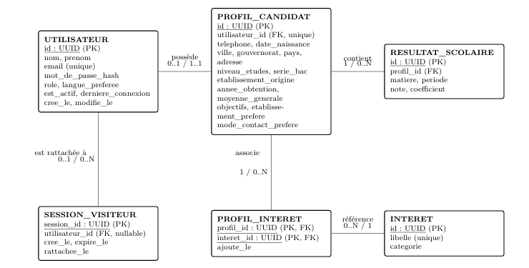

# SA-13 — Conception des tables utilisateurs et profils

> **Projet :** SmartCampus AI (IIT / ISB) 
> **Modèle de données :** PostgreSQL, version 1.0 
> **Source :** document SA-13 transmis avec la demande

## 1. Objectif et périmètre

Cette tâche définit les données nécessaires à la gestion des comptes utilisateurs et des profils candidats de SmartCampus AI. Elle comprend le modèle entité-association, le modèle logique, le dictionnaire des champs, les contraintes d’intégrité et un script SQL de référence.

La conception est indépendante du framework applicatif retenu. Le script SQL cible PostgreSQL.

**Hors périmètre :** le stockage détaillé des messages de conversation, le contenu des dossiers de candidature, les rendez-vous et les décisions d’admission. Ces données relèvent d’autres fonctionnalités et tâches du projet. La table `session_visiteur` sert uniquement à identifier une session et à la rattacher à un compte.

## 2. Décisions de conception

1. Les identifiants techniques sont des UUID. Ils évitent les identifiants séquentiels prévisibles et s’alignent sur l’identifiant de session visiteur transmis dans `X-Session-Id`.
2. Un compte possède un seul rôle : `candidat` ou `admin`.
3. Un visiteur non inscrit ne possède pas de compte. Il est identifié par une session visiteur.
4. Un compte candidat possède au maximum un profil candidat. Un compte administrateur ne possède pas de profil candidat.
5. Les résultats scolaires et les intérêts sont stockés dans des tables séparées, puisqu’un candidat peut en avoir plusieurs.
6. L’adresse e-mail est unique sans distinction de casse. Le mot de passe est stocké uniquement sous forme de hash.
7. Une session visiteur peut être rattachée à un compte lors de l’inscription ou de la connexion, afin de préserver la continuité de la conversation.
8. La complétude du profil est évaluée dans une vue : niveau d’études, au moins un résultat scolaire, au moins un intérêt et objectifs renseignés.

## 3. Règles de gestion

1. Chaque compte est identifié de manière unique par son UUID.
2. L’adresse e-mail est obligatoire et unique, sans distinction de casse.
3. Le mot de passe n’est jamais stocké en clair ; seul son hash est conservé.
4. Le rôle d’un compte est obligatoirement `candidat` ou `admin`.
5. Seul un compte candidat peut posséder un profil candidat.
6. Un candidat possède au maximum un profil candidat.
7. Un profil peut contenir plusieurs résultats scolaires.
8. Un profil peut être associé à plusieurs intérêts ; un même intérêt peut être associé à plusieurs profils.
9. Un résultat est identifié par son UUID et ne peut pas être dupliqué pour le même profil, la même matière et la même période.
10. Une session visiteur est identifiée par un UUID. Avant son rattachement, `utilisateur_id` est nul. Après inscription ou connexion, cette colonne référence le compte concerné.
11. Un candidat ne peut consulter et modifier que son propre profil. L’API contrôle effectivement les autorisations ; le modèle relationnel seul ne les garantit pas.
12. Un profil est complet lorsque le niveau d’études, au moins un résultat scolaire, au moins un intérêt et les objectifs sont renseignés.

## 4. Modèle entité-association

Le diagramme présente les comptes, les profils candidats, les résultats scolaires, les intérêts et les sessions visiteur.

Les clés primaires sont soulignées dans le diagramme. Les clés étrangères sont indiquées par `FK`, et les cardinalités sont présentées près des relations.

- Un compte candidat possède zéro ou un profil dans le modèle général ; un compte administrateur n’en possède aucun.
- Un profil candidat peut avoir zéro ou plusieurs résultats scolaires.
- La relation entre profils et intérêts est plusieurs-à-plusieurs et passe par `profil_interet`.
- Une session visiteur peut être rattachée à zéro ou un compte. Un compte peut être associé à plusieurs sessions.

## 5. Modèle logique des données

| Table | Clés | Contraintes principales |
|---|---|---|
| `utilisateur` | PK : `id` | E-mail unique sans distinction de casse ; rôle contrôlé. |
| `profil_candidat` | PK : `id` ; FK : `utilisateur_id` | FK unique ; suppression en cascade depuis `utilisateur`. |
| `resultat_scolaire` | PK : `id` ; FK : `profil_id` | Note entre 0 et 20 ; unicité du triplet profil/matière/période. |
| `interet` | PK : `id` | Libellé unique. |
| `profil_interet` | PK composée : `profil_id`, `interet_id` ; deux FK | Suppression du lien si le profil est supprimé ; intérêt protégé s’il est utilisé. |
| `session_visiteur` | PK : `session_id` ; FK nullable : `utilisateur_id` | À la suppression du compte, le rattachement devient nul. |

## 6. Dictionnaire des données

### 6.1 Table `utilisateur`

| Champ | Type | Contraintes | Description |
|---|---|---|---|
| `id` | UUID | PK, obligatoire | Identifiant du compte. |
| `nom` | VARCHAR(100) | Obligatoire | Nom de famille. |
| `prenom` | VARCHAR(100) | Obligatoire | Prénom. |
| `email` | VARCHAR(255) | Obligatoire, unique sans distinction de casse | Identifiant de connexion. |
| `mot_de_passe_hash` | VARCHAR(255) | Obligatoire | Hash du mot de passe ; le mot de passe en clair n’est jamais conservé. |
| `role` | `role_utilisateur` | Obligatoire, défaut `candidat` | Rôle `candidat` ou `admin`. |
| `langue_preferee` | `langue_echange` | Obligatoire, défaut `fr` | Langue préférée pour les échanges. |
| `est_actif` | BOOLEAN | Obligatoire, défaut TRUE | État du compte. |
| `derniere_connexion` | TIMESTAMPTZ | Facultatif | Date du dernier accès. |
| `cree_le` | TIMESTAMPTZ | Obligatoire, défaut `now()` | Date de création. |
| `modifie_le` | TIMESTAMPTZ | Obligatoire, défaut `now()` | Date de dernière modification. |

### 6.2 Table `profil_candidat`

| Champ | Type | Contraintes | Description |
|---|---|---|---|
| `id` | UUID | PK, obligatoire | Identifiant du profil. |
| `utilisateur_id` | UUID | FK, unique, obligatoire | Compte associé au profil. |
| `telephone` | VARCHAR(20) | Facultatif, format contrôlé | Numéro de téléphone. |
| `date_naissance` | DATE | Facultatif, date passée ou égale à aujourd’hui | Date de naissance. |
| `ville` | VARCHAR(100) | Facultatif | Ville de résidence. |
| `gouvernorat` | VARCHAR(50) | Facultatif | Gouvernorat. |
| `pays` | VARCHAR(60) | Défaut `Tunisie` | Pays de résidence. |
| `adresse` | TEXT | Facultatif | Adresse postale. |
| `niveau_etudes` | VARCHAR(100) | Facultatif à la création | Niveau scolaire ou universitaire actuel. |
| `serie_bac` | VARCHAR(60) | Facultatif | Section du baccalauréat, si applicable. |
| `etablissement_origine` | VARCHAR(150) | Facultatif | Établissement actuel ou précédent. |
| `annee_obtention` | SMALLINT | Facultatif, entre 1990 et 2100 | Année d’obtention du diplôme. |
| `moyenne_generale` | NUMERIC(4,2) | Facultatif, entre 0 et 20 | Moyenne générale. |
| `objectifs` | TEXT | Facultatif à la création | Objectifs académiques ou professionnels. |
| `etablissement_prefere` | `etablissement_cible` | Défaut `indifferent` | Établissement visé : IIT, ISB ou indifférent. |
| `mode_contact_prefere` | `mode_contact` | Défaut `email` | Canal de contact préféré. |
| `cree_le` | TIMESTAMPTZ | Obligatoire, défaut `now()` | Date de création. |
| `modifie_le` | TIMESTAMPTZ | Obligatoire, défaut `now()` | Date de modification. |

### 6.3 Table `resultat_scolaire`

| Champ | Type | Contraintes | Description |
|---|---|---|---|
| `id` | UUID | PK, obligatoire | Identifiant du résultat. |
| `profil_id` | UUID | FK, obligatoire | Profil concerné. |
| `matiere` | VARCHAR(100) | Obligatoire | Matière ou épreuve. |
| `periode` | VARCHAR(50) | Obligatoire | Période ou examen concerné. |
| `note` | NUMERIC(4,2) | Obligatoire, entre 0 et 20 | Note obtenue. |
| `coefficient` | NUMERIC(4,2) | Obligatoire, supérieur à 0, défaut 1 | Coefficient de la matière. |

### 6.4 Tables `interet` et `profil_interet`

| Table / champ | Type | Contraintes | Description |
|---|---|---|---|
| `interet.id` | UUID | PK, obligatoire | Identifiant de l’intérêt. |
| `interet.libelle` | VARCHAR(100) | Obligatoire, unique | Libellé, par exemple IA ou génie logiciel. |
| `interet.categorie` | VARCHAR(60) | Facultatif | Catégorie de l’intérêt. |
| `profil_interet.profil_id` | UUID | PK composée, FK | Profil concerné. |
| `profil_interet.interet_id` | UUID | PK composée, FK | Intérêt sélectionné. |
| `profil_interet.ajoute_le` | TIMESTAMPTZ | Obligatoire, défaut `now()` | Date d’association. |

### 6.5 Table `session_visiteur`

| Champ | Type | Contraintes | Description |
|---|---|---|---|
| `session_id` | UUID | PK, obligatoire | Identifiant transmis dans l’en-tête `X-Session-Id`. |
| `utilisateur_id` | UUID | FK, nullable | Compte auquel la session est rattachée. |
| `cree_le` | TIMESTAMPTZ | Obligatoire, défaut `now()` | Date de création de la session. |
| `expire_le` | TIMESTAMPTZ | Obligatoire | Date d’expiration. |
| `rattachee_le` | TIMESTAMPTZ | Facultatif | Date du rattachement au compte. |

## 7. Contraintes et intégrité des données

- Les clés étrangères garantissent la cohérence des associations entre les tables.
- La suppression d’un utilisateur entraîne la suppression de son profil et des résultats et intérêts associés.
- La suppression d’un utilisateur ne supprime pas nécessairement sa session : le rattachement devient nul (`ON DELETE SET NULL`).
- La suppression d’un intérêt déjà utilisé est interdite afin de préserver l’intégrité des associations.
- Les notes et moyennes sont comprises entre 0 et 20.
- Les autorisations d’accès aux profils sont appliquées par l’API. Une politique PostgreSQL de sécurité au niveau des lignes (RLS) pourra être ajoutée si l’architecture technique le nécessite.

## 8. Lien indicatif avec l’API

Les routes suivantes illustrent l’utilisation possible des tables et doivent être alignées avec les contrats d’API correspondants.

| Route | Tables utilisées | Rôle / usage |
|---|---|---|
| `POST /auth/register` | `utilisateur`, `session_visiteur` | Création du compte et rattachement de la session. |
| `POST /auth/login` | `utilisateur`, `session_visiteur` | Authentification et rattachement éventuel de la session. |
| `GET /me/profil` | `profil_candidat` et tables liées | Consultation du profil du candidat connecté. |
| `PUT /me/profil` | `profil_candidat` | Modification du profil du candidat connecté. |
| `GET /admin/users` | `utilisateur` | Gestion des comptes par un administrateur autorisé. |

## 9. Script SQL de référence PostgreSQL

Le script ci-dessous normalise la typographie SQL du document source. Il constitue une base de travail pour SA-17, après validation de la conception.

~~~sql
-- Prérequis pour gen_random_uuid() sur PostgreSQL 12.
CREATE EXTENSION IF NOT EXISTS pgcrypto;

CREATE TYPE role_utilisateur AS ENUM ('candidat', 'admin');
CREATE TYPE langue_echange AS ENUM ('fr', 'tunisien', 'arabizi');
CREATE TYPE etablissement_cible AS ENUM ('IIT', 'ISB', 'indifferent');
CREATE TYPE mode_contact AS ENUM ('email', 'telephone');

CREATE TABLE utilisateur (
    id UUID PRIMARY KEY DEFAULT gen_random_uuid(),
    nom VARCHAR(100) NOT NULL,
    prenom VARCHAR(100) NOT NULL,
    email VARCHAR(255) NOT NULL,
    mot_de_passe_hash VARCHAR(255) NOT NULL,
    role role_utilisateur NOT NULL DEFAULT 'candidat',
    langue_preferee langue_echange NOT NULL DEFAULT 'fr',
    est_actif BOOLEAN NOT NULL DEFAULT TRUE,
    derniere_connexion TIMESTAMPTZ,
    cree_le TIMESTAMPTZ NOT NULL DEFAULT now(),
    modifie_le TIMESTAMPTZ NOT NULL DEFAULT now(),
    CONSTRAINT ck_email_format
        CHECK (email ~* '^[^@\s]+@[^@\s]+\.[^@\s]+$')
);

CREATE UNIQUE INDEX ux_utilisateur_email_lower
    ON utilisateur (lower(email));

CREATE TABLE profil_candidat (
    id UUID PRIMARY KEY DEFAULT gen_random_uuid(),
    utilisateur_id UUID NOT NULL UNIQUE
        REFERENCES utilisateur(id) ON DELETE CASCADE,
    telephone VARCHAR(20)
        CHECK (telephone IS NULL OR telephone ~ '^\+?[0-9]{8,15}$'),
    date_naissance DATE
        CHECK (date_naissance IS NULL OR date_naissance <= CURRENT_DATE),
    ville VARCHAR(100),
    gouvernorat VARCHAR(50),
    pays VARCHAR(60) NOT NULL DEFAULT 'Tunisie',
    adresse TEXT,
    niveau_etudes VARCHAR(100),
    serie_bac VARCHAR(60),
    etablissement_origine VARCHAR(150),
    annee_obtention SMALLINT
        CHECK (annee_obtention IS NULL OR annee_obtention BETWEEN 1990 AND 2100),
    moyenne_generale NUMERIC(4,2)
        CHECK (moyenne_generale IS NULL OR moyenne_generale BETWEEN 0 AND 20),
    objectifs TEXT,
    etablissement_prefere etablissement_cible NOT NULL DEFAULT 'indifferent',
    mode_contact_prefere mode_contact NOT NULL DEFAULT 'email',
    cree_le TIMESTAMPTZ NOT NULL DEFAULT now(),
    modifie_le TIMESTAMPTZ NOT NULL DEFAULT now()
);

CREATE FUNCTION verifier_role_profil_candidat()
RETURNS TRIGGER
LANGUAGE plpgsql
AS $$
DECLARE
    role_compte role_utilisateur;
BEGIN
    SELECT role INTO role_compte
    FROM utilisateur
    WHERE id = NEW.utilisateur_id;

    IF role_compte IS DISTINCT FROM 'candidat' THEN
        RAISE EXCEPTION
            'Un profil candidat doit appartenir à un utilisateur de rôle candidat';
    END IF;

    RETURN NEW;
END;
$$;

CREATE TRIGGER trg_verifier_role_profil
BEFORE INSERT OR UPDATE OF utilisateur_id ON profil_candidat
FOR EACH ROW
EXECUTE FUNCTION verifier_role_profil_candidat();

CREATE TABLE resultat_scolaire (
    id UUID PRIMARY KEY DEFAULT gen_random_uuid(),
    profil_id UUID NOT NULL
        REFERENCES profil_candidat(id) ON DELETE CASCADE,
    matiere VARCHAR(100) NOT NULL,
    periode VARCHAR(50) NOT NULL,
    note NUMERIC(4,2) NOT NULL CHECK (note BETWEEN 0 AND 20),
    coefficient NUMERIC(4,2) NOT NULL DEFAULT 1 CHECK (coefficient > 0),
    CONSTRAINT uq_resultat_profil_matiere_periode
        UNIQUE (profil_id, matiere, periode)
);

CREATE TABLE interet (
    id UUID PRIMARY KEY DEFAULT gen_random_uuid(),
    libelle VARCHAR(100) NOT NULL UNIQUE,
    categorie VARCHAR(60)
);

CREATE TABLE profil_interet (
    profil_id UUID NOT NULL
        REFERENCES profil_candidat(id) ON DELETE CASCADE,
    interet_id UUID NOT NULL
        REFERENCES interet(id) ON DELETE RESTRICT,
    ajoute_le TIMESTAMPTZ NOT NULL DEFAULT now(),
    PRIMARY KEY (profil_id, interet_id)
);

CREATE TABLE session_visiteur (
    session_id UUID PRIMARY KEY DEFAULT gen_random_uuid(),
    utilisateur_id UUID
        REFERENCES utilisateur(id) ON DELETE SET NULL,
    cree_le TIMESTAMPTZ NOT NULL DEFAULT now(),
    expire_le TIMESTAMPTZ NOT NULL,
    rattachee_le TIMESTAMPTZ,
    CONSTRAINT ck_session_expiration CHECK (expire_le > cree_le),
    CONSTRAINT ck_session_rattachement
        CHECK (
            (utilisateur_id IS NULL AND rattachee_le IS NULL)
            OR
            (utilisateur_id IS NOT NULL AND rattachee_le IS NOT NULL)
        )
);

CREATE INDEX ix_profil_utilisateur
    ON profil_candidat(utilisateur_id);
CREATE INDEX ix_resultat_profil
    ON resultat_scolaire(profil_id);
CREATE INDEX ix_profil_interet_interet
    ON profil_interet(interet_id);
CREATE INDEX ix_session_utilisateur
    ON session_visiteur(utilisateur_id);
CREATE INDEX ix_session_expiration
    ON session_visiteur(expire_le);

CREATE FUNCTION mettre_a_jour_modifie_le()
RETURNS TRIGGER
LANGUAGE plpgsql
AS $$
BEGIN
    NEW.modifie_le = now();
    RETURN NEW;
END;
$$;

CREATE TRIGGER trg_utilisateur_modifie_le
BEFORE UPDATE ON utilisateur
FOR EACH ROW
EXECUTE FUNCTION mettre_a_jour_modifie_le();

CREATE TRIGGER trg_profil_modifie_le
BEFORE UPDATE ON profil_candidat
FOR EACH ROW
EXECUTE FUNCTION mettre_a_jour_modifie_le();

CREATE VIEW v_profil_completude AS
SELECT
    p.id AS profil_id,
    (p.niveau_etudes IS NOT NULL
        AND length(trim(p.niveau_etudes)) > 0) AS niveau_ok,
    EXISTS (
        SELECT 1 FROM resultat_scolaire r WHERE r.profil_id = p.id
    ) AS resultats_ok,
    EXISTS (
        SELECT 1 FROM profil_interet pi WHERE pi.profil_id = p.id
    ) AS interets_ok,
    (p.objectifs IS NOT NULL
        AND length(trim(p.objectifs)) > 0) AS objectifs_ok,
    (
        p.niveau_etudes IS NOT NULL
        AND length(trim(p.niveau_etudes)) > 0
        AND EXISTS (
            SELECT 1 FROM resultat_scolaire r WHERE r.profil_id = p.id
        )
        AND EXISTS (
            SELECT 1 FROM profil_interet pi WHERE pi.profil_id = p.id
        )
        AND p.objectifs IS NOT NULL
        AND length(trim(p.objectifs)) > 0
    ) AS est_complet
FROM profil_candidat p;
~~~

> **Point de cohérence à valider avant exécution :** `ck_session_rattachement` exige que `rattachee_le` soit nul lorsque `utilisateur_id` est nul. La clé étrangère `ON DELETE SET NULL` ne met pas automatiquement `rattachee_le` à NULL ; supprimer un compte déjà rattaché pourrait donc être bloqué par cette contrainte. La règle de conservation du rattachement doit être arbitrée avant d’exécuter ce DDL.
