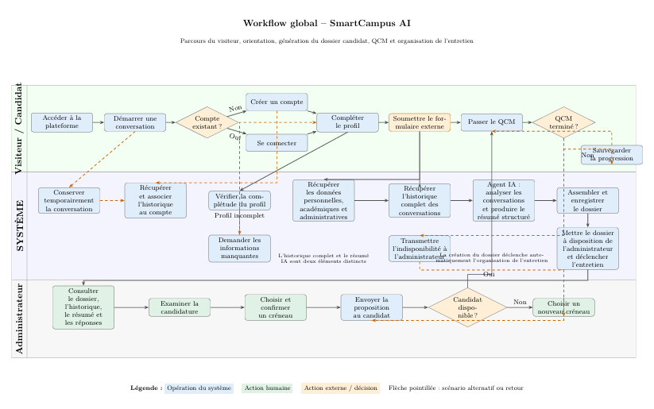

# SA-3 — Acteurs et processus métiers

> **Projet :** SmartCampus AI (IIT / ISB) 
> **Source :** document « Acteurs et processus métiers » transmis pour la tâche SA-3

## 1. Objectif et périmètre

SmartCampus AI est une plateforme d’orientation universitaire destinée aux futurs étudiants de l’IIT et de l’ISB.

La plateforme permet de :

- Dialoguer en français, en dialecte tunisien ou en Arabizi.
- Découvrir les formations et recevoir des recommandations personnalisées.
- Accéder à la préinscription au moyen d’un formulaire externe.
- Passer un QCM personnalisé et reprendre une tentative interrompue.
- Organiser un entretien avec l’administrateur.
- Suivre l’avancement d’un dossier de candidature.

La plateforme assiste les candidats et les responsables. La décision officielle d’admission reste une décision humaine.

## 2. Acteurs et responsabilités

| Acteur | Responsabilités et besoins |
|---|---|
| **Visiteur** | Accéder à la plateforme sans compte, démarrer une conversation et découvrir les formations. |
| **Candidat** | Créer un compte, compléter son profil, consulter les recommandations, accéder au formulaire externe, passer ou reprendre le QCM, consulter son dossier et ses rendez-vous. |
| **Administrateur** | Gérer les comptes, les rôles, les formations, les QCM, les paramètres et le fonctionnement de l’application. Consulter les dossiers, l’historique complet des conversations et le résumé structuré généré par l’IA. Examiner les candidatures, demander des informations complémentaires, confirmer les créneaux d’entretien et traiter les demandes de changement. L’administrateur représente la direction pour la gestion de la plateforme. |

> **Composant interne :** l’agent IA intervient dans les échanges et l’analyse. Il n’est pas un acteur métier et ne prend aucune décision officielle d’admission.

## 3. Processus métier

### 3.1 Accès et orientation

1. Le visiteur accède à la plateforme et démarre une conversation sans créer de compte.
2. Le système conserve temporairement la conversation.
3. Le visiteur peut créer un compte pour devenir candidat.
4. Après la création du compte, la conversation précédente est récupérée et associée au compte du candidat.
5. Le candidat complète son profil : niveau d’études, résultats, intérêts et objectifs.
6. Le système analyse les informations et consulte les sources officielles afin de proposer des formations adaptées.

### 3.2 Préinscription et QCM

1. Le candidat accède au formulaire de préinscription au moyen d’un lien externe.
2. Il complète et soumet son dossier.
3. Il passe le QCM personnalisé.
4. Si le QCM est interrompu, sa progression est sauvegardée.
5. Le candidat peut reprendre le QCM à partir de sa dernière progression enregistrée.

### 3.3 Traitement du dossier

1. L’administrateur consulte le dossier, l’historique du candidat et ses réponses.
2. Il examine la candidature.
3. Il peut accepter le dossier, demander des informations complémentaires ou le refuser.
4. En cas de demande de complément, le candidat reçoit la demande et peut compléter son dossier.

### 3.4 Organisation de l’entretien

1. Le système propose des créneaux disponibles à l’administrateur.
2. L’administrateur choisit et confirme un créneau.
3. Le candidat reçoit la proposition de rendez-vous.
4. Si le candidat accepte, le rendez-vous est confirmé.
5. Si le candidat est indisponible, il en informe le système.
6. Le système transmet l’information à l’administrateur.
7. L’administrateur choisit et confirme un nouveau créneau.
8. Le candidat reçoit la nouvelle proposition.
9. Le processus se répète jusqu’à la confirmation du rendez-vous.

## 4. Règles de gestion et situations particulières

| Situation | Règle de gestion |
|---|---|
| **Conversation sans compte** | La conversation reste temporaire. Après la création du compte, elle est récupérée et associée au candidat. |
| **Profil incomplet** | Le système demande les informations manquantes avant de proposer une orientation précise. |
| **Formulaire de préinscription** | Le candidat est redirigé vers un lien externe pour remplir le formulaire. |
| **Soumission du formulaire** | La soumission déclenche la récupération des informations du candidat et de l’historique complet des conversations, puis la génération et l’enregistrement du dossier. |
| **Résumé généré par l’IA** | L’agent IA est un composant interne. Il analyse les conversations et produit un résumé structuré distinct de l’historique complet. |
| **Contenu du dossier candidat** | Le dossier regroupe les informations personnelles, académiques et administratives du candidat ainsi que le résumé structuré généré par l’IA. L’historique complet reste distinct et est également accessible à l’administrateur. |
| **Déclenchement de l’entretien** | La création et l’enregistrement du dossier déclenchent automatiquement le processus d’organisation de l’entretien. |
| **QCM interrompu** | La progression est sauvegardée afin que le candidat puisse reprendre le QCM. |
| **Dossier incomplet** | L’administrateur peut demander des informations complémentaires au candidat. |
| **Candidat indisponible** | L’administrateur confirme un autre créneau avant de le proposer au candidat. |
| **Décision d’admission** | La décision officielle est prise par un responsable humain. |

## Workflow global

Le diagramme ci-dessous synthétise les parcours décrits dans le document : orientation, préinscription, QCM, examen du dossier et organisation de l’entretien.

## 5. Points de fonctionnement retenus

- La création d’un compte permet de conserver l’historique du candidat et de récupérer sa conversation temporaire.
- Le formulaire de préinscription est externe à la plateforme.
- La progression du QCM est sauvegardée pour permettre sa reprise.
- L’administrateur confirme toujours le créneau avant de le proposer au candidat.
- L’administrateur peut consulter l’historique et les réponses du candidat.
- L’agent IA intervient dans les échanges, l’analyse du profil et l’organisation du processus. Il n’est pas un acteur métier et ne prend aucune décision officielle d’admission.
- L’administrateur assure la gestion technique et fonctionnelle de l’application au nom de la direction.
