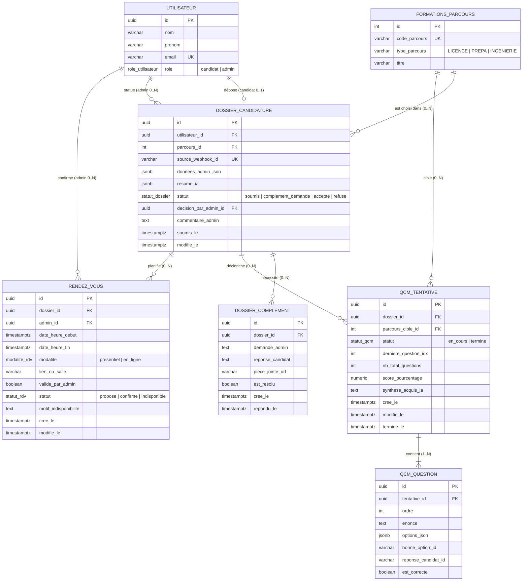

# SmartCampus AI — Livrable Tâche SA-14 : Conception des Tables de Gestion (Préinscription, QCM & Entretiens)

* **Tâche Jira :** SA-14 — Concevoir les tables de gestion (préinscription/RDV)[cite: 10, 23]
* **Responsable :** Amina Kallel[cite: 10, 23]
* **Alignement inter-équipe :**
  * **Manar (SA-13) :** Référencement de la table `utilisateur(id UUID)`[cite: 43, 46]
  * **Tasnime (SA-12) :** Référencement de la table `formations_parcours(id SERIAL / INTEGER)`[cite: 49, 50]
  * **Yasmine (SA-16/SA-17) :** Script de migration PostgreSQL prêt à exécuter[cite: 7, 10, 23]

---

## 1. Schéma Relationnel (Diagramme ER / MLD)



---

## 2. Décisions de Compatibilité & Règles de Gestion

### Alignement technique avec SA-12 et SA-13
1. **Types des clés étrangères harmonisés :**
   * Les références vers `utilisateur(id)` (SA-13) utilisent le type **`UUID`**[cite: 43, 46].
   * Les références vers `formations_parcours(id)` (SA-12) utilisent le type **`INTEGER`** (correspondant au `SERIAL` de Tasnime)[cite: 49, 50].
2. **Conventions de nommage uniformes :** Utilisation des colonnes d'audit `cree_le` et `modifie_le` avec réutilisation du trigger `mettre_a_jour_modifie_le()` défini dans SA-13[cite: 44, 48].
3. **Contrôle des rôles par triggers PostgreSQL :** À l'image de SA-13, des triggers garantissent qu'un `dossier_candidature` ne peut être créé que pour un utilisateur de rôle `'candidat'`, et que `decision_par_admin_id` / `admin_id` référencent obligatoirement un utilisateur de rôle `'admin'`[cite: 18, 26, 47].

### Règles métiers (Architecture SA-4)
* **Création via Webhook (Règle n°4) :** La réception du formulaire externe crée automatiquement le dossier au statut `soumis` et déclenche l'organisation de l'entretien (Règle n°7)[cite: 18, 19, 26, 27].
* **Séparation Dossier / Historique (Règle n°6) :** `dossier_candidature.resume_ia` stocke le résumé structuré généré par l'agent IA ; l'historique brut reste isolé dans la table des conversations[cite: 18, 26].
* **Décision 100 % humaine (Règle n°2) :** Seul un `admin` peut faire passer un dossier à `accepte` ou `refuse`[cite: 18, 19, 26, 27].
* **Reprise du QCM (Règle n°9) :** La progression (`derniere_question_idx` et les réponses dans `qcm_question`) est sauvegardée après chaque question[cite: 13, 18, 32, 37].
* **Verrou administrateur sur les entretiens (Règle n°10) :** L'agent `Entretien` insère un créneau avec `valide_par_admin = FALSE`. Le candidat ne reçoit la proposition qu'après confirmation par l'administrateur (`TRUE`)[cite: 13, 18, 26, 37].

---

## 3. Dictionnaire Détaillé des Tables

### 3.1 Table `dossier_candidature`

| Champ | Type PostgreSQL | Contraintes | Description |
| :--- | :--- | :--- | :--- |
| `id` | `UUID` | `PK, DEFAULT gen_random_uuid()` | Identifiant unique du dossier. |
| `utilisateur_id` | `UUID` | `FK -> utilisateur(id), UNIQUE, NOT NULL` | Compte candidat propriétaire (rôle `candidat` vérifié)[cite: 12, 31, 46]. |
| `parcours_id` | `INTEGER` | `FK -> formations_parcours(id), NOT NULL` | Parcours IIT/ISB choisi lors de la préinscription[cite: 1, 12, 50]. |
| `source_webhook_id` | `VARCHAR(100)` | `UNIQUE, NULL` | Identifiant externe du formulaire (idempotence du webhook)[cite: 18, 19]. |
| `donnees_admin_json` | `JSONB` | `NOT NULL, DEFAULT '{}'` | Données administratives soumises (CIN, lycée, pièces)[cite: 13, 32]. |
| `resume_ia` | `JSONB` | `NULL` | Résumé structuré généré par l'agent Dossier (distinct du chat)[cite: 18, 25, 26]. |
| `statut` | `statut_dossier` | `NOT NULL, DEFAULT 'soumis'` | Enum : `'soumis'`, `'complement_demande'`, `'accepte'`, `'refuse'`[cite: 19, 27]. |
| `decision_par_admin_id` | `UUID` | `FK -> utilisateur(id), NULL` | Administrateur ayant pris la décision humaine finale[cite: 18, 26, 46]. |
| `commentaire_admin` | `TEXT` | `NULL` | Motif du refus ou détail du complément demandé[cite: 13, 17]. |
| `soumis_le` | `TIMESTAMPTZ` | `NOT NULL, DEFAULT now()` | Date de soumission via le webhook[cite: 19, 27]. |
| `modifie_le` | `TIMESTAMPTZ` | `NOT NULL, DEFAULT now()` | Date de dernière mise à jour[cite: 44]. |

---

### 3.2 Table `dossier_complement`

| Champ | Type PostgreSQL | Contraintes | Description |
| :--- | :--- | :--- | :--- |
| `id` | `UUID` | `PK, DEFAULT gen_random_uuid()` | Identifiant unique de la demande de complément. |
| `dossier_id` | `UUID` | `FK -> dossier_candidature(id) ON DELETE CASCADE` | Dossier concerné[cite: 13, 32]. |
| `demande_admin` | `TEXT` | `NOT NULL` | Information ou document demandé par l'administrateur[cite: 13, 32]. |
| `reponse_candidat` | `TEXT` | `NULL` | Réponse fournie par le candidat[cite: 13, 32]. |
| `piece_jointe_url` | `VARCHAR(500)` | `NULL` | Lien vers le document complémentaire déposé. |
| `est_resolu` | `BOOLEAN` | `NOT NULL, DEFAULT FALSE` | Passe à `TRUE` dès la réponse du candidat[cite: 13]. |
| `cree_le` | `TIMESTAMPTZ` | `NOT NULL, DEFAULT now()` | Date de la demande de l'administrateur[cite: 44]. |
| `repondu_le` | `TIMESTAMPTZ` | `NULL` | Date de réponse du candidat. |

---

### 3.3 Table `qcm_tentative`

| Champ | Type PostgreSQL | Contraintes | Description |
| :--- | :--- | :--- | :--- |
| `id` | `UUID` | `PK, DEFAULT gen_random_uuid()` | Identifiant unique de la tentative de QCM. |
| `dossier_id` | `UUID` | `FK -> dossier_candidature(id) ON DELETE CASCADE` | Dossier associé[cite: 12, 31]. |
| `parcours_cible_id` | `INTEGER` | `FK -> formations_parcours(id), NOT NULL` | Formation/parcours évalué par le QCM adaptatif[cite: 1, 3, 4, 50]. |
| `statut` | `statut_qcm` | `NOT NULL, DEFAULT 'en_cours'` | Enum : `'en_cours'`, `'termine'`[cite: 12, 14]. |
| `derniere_question_idx` | `INTEGER` | `NOT NULL, DEFAULT 0, CHECK (>= 0)` | Index de reprise après interruption[cite: 12, 18, 26]. |
| `nb_total_questions` | `INTEGER` | `NOT NULL, CHECK (> 0)` | Nombre total de questions du QCM. |
| `score_pourcentage` | `NUMERIC(5,2)` | `NULL, CHECK (BETWEEN 0 AND 100)` | Score final calculé à la soumission[cite: 4]. |
| `synthese_acquis_ia` | `TEXT` | `NULL` | Synthèse des acquis et points à approfondir pour l'entretien[cite: 2, 4]. |
| `cree_le` | `TIMESTAMPTZ` | `NOT NULL, DEFAULT now()` | Date de démarrage du QCM[cite: 44]. |
| `modifie_le` | `TIMESTAMPTZ` | `NOT NULL, DEFAULT now()` | Date de dernière sauvegarde de progression[cite: 12, 18, 44]. |
| `termine_le` | `TIMESTAMPTZ` | `NULL` | Date de soumission finale. |

---

### 3.4 Table `qcm_question`

| Champ | Type PostgreSQL | Contraintes | Description |
| :--- | :--- | :--- | :--- |
| `id` | `UUID` | `PK, DEFAULT gen_random_uuid()` | Identifiant unique de la question. |
| `tentative_id` | `UUID` | `FK -> qcm_tentative(id) ON DELETE CASCADE` | Tentative parente. |
| `ordre` | `INTEGER` | `NOT NULL, CHECK (>= 1), UNIQUE(tentative_id, ordre)` | Numéro d'ordre de la question (`1..N`). |
| `enonce` | `TEXT` | `NOT NULL` | Intitulé de la question générée[cite: 2]. |
| `options_json` | `JSONB` | `NOT NULL` | Liste des choix (`[{"id": "a", "texte": "..."}, ...]`). |
| `bonne_option_id` | `VARCHAR(10)` | `NOT NULL` | Identifiant de la bonne réponse attendue. |
| `reponse_candidat_id` | `VARCHAR(10)` | `NULL` | Choix sélectionné par le candidat (`NULL` si non répondu)[cite: 2, 17]. |
| `est_correcte` | `BOOLEAN` | `NULL` | Indique si la réponse du candidat est correcte. |

---

### 3.5 Table `rendez_vous`

| Champ | Type PostgreSQL | Contraintes | Description |
| :--- | :--- | :--- | :--- |
| `id` | `UUID` | `PK, DEFAULT gen_random_uuid()` | Identifiant unique du rendez-vous. |
| `dossier_id` | `UUID` | `FK -> dossier_candidature(id) ON DELETE CASCADE` | Dossier déclencheur de l'entretien[cite: 13, 18, 26]. |
| `admin_id` | `UUID` | `FK -> utilisateur(id), NULL` | Administrateur ayant confirmé le créneau (rôle `admin` vérifié)[cite: 13, 18, 26, 46]. |
| `date_heure_debut` | `TIMESTAMPTZ` | `NOT NULL` | Date et heure de début du créneau. |
| `date_heure_fin` | `TIMESTAMPTZ` | `NOT NULL, CHECK (date_heure_fin > date_heure_debut)` | Date et heure de fin du créneau. |
| `modalite` | `modalite_rdv` | `NOT NULL, DEFAULT 'presentiel'` | Enum : `'presentiel'`, `'en_ligne'`. |
| `lien_ou_salle` | `VARCHAR(255)` | `NULL` | Salle IIT/ISB ou lien de visioconférence. |
| `valide_par_admin` | `BOOLEAN` | `NOT NULL, DEFAULT FALSE` | **Verrou métier :** doit être `TRUE` avant proposition au candidat[cite: 13, 18, 26]. |
| `statut` | `statut_rdv` | `NOT NULL, DEFAULT 'propose'` | Enum : `'propose'`, `'confirme'`, `'indisponible'`[cite: 19, 27]. |
| `motif_indisponibilite` | `TEXT` | `NULL` | Contraintes horaires saisies si `statut = 'indisponible'`[cite: 13, 32]. |
| `cree_le` | `TIMESTAMPTZ` | `NOT NULL, DEFAULT now()` | Date de proposition du créneau[cite: 44]. |
| `modifie_le` | `TIMESTAMPTZ` | `NOT NULL, DEFAULT now()` | Date de dernière mise à jour[cite: 44]. |

---

## 4. Script SQL PostgreSQL de Référence (`migration_SA14_gestion.sql`)

*Prérequis : exécuter après les migrations de `utilisateur` (SA-13)[cite: 46] et `formations_parcours` (SA-12)[cite: 50].*

```sql
-- ============================================================================
-- SmartCampus AI - Script SQL SA-14 : Gestion Préinscription, QCM & Entretiens
-- Compatible avec SA-13 (utilisateur : UUID) et SA-12 (formations_parcours : INT)
-- ============================================================================

-- Types énumérés applicatifs (alignés avec SA-4 et SA-13)
CREATE TYPE statut_dossier AS ENUM ('soumis', 'complement_demande', 'accepte', 'refuse');
CREATE TYPE statut_qcm AS ENUM ('en_cours', 'termine');
CREATE TYPE modalite_rdv AS ENUM ('presentiel', 'en_ligne');
CREATE TYPE statut_rdv AS ENUM ('propose', 'confirme', 'indisponible');

-- 1. Table des dossiers de candidature
CREATE TABLE dossier_candidature (
    id UUID PRIMARY KEY DEFAULT gen_random_uuid(),
    utilisateur_id UUID NOT NULL UNIQUE
        REFERENCES utilisateur (id) ON DELETE CASCADE,
    parcours_id INTEGER NOT NULL
        REFERENCES formations_parcours (id) ON DELETE RESTRICT,
    source_webhook_id VARCHAR(100) UNIQUE,
    donnees_admin_json JSONB NOT NULL DEFAULT '{}'::jsonb,
    resume_ia JSONB,
    statut statut_dossier NOT NULL DEFAULT 'soumis',
    decision_par_admin_id UUID
        REFERENCES utilisateur (id) ON DELETE SET NULL,
    commentaire_admin TEXT,
    soumis_le TIMESTAMPTZ NOT NULL DEFAULT now(),
    modifie_le TIMESTAMPTZ NOT NULL DEFAULT now()
);

-- 2. Table des demandes de compléments d'information
CREATE TABLE dossier_complement (
    id UUID PRIMARY KEY DEFAULT gen_random_uuid(),
    dossier_id UUID NOT NULL
        REFERENCES dossier_candidature (id) ON DELETE CASCADE,
    demande_admin TEXT NOT NULL,
    reponse_candidat TEXT,
    piece_jointe_url VARCHAR(500),
    est_resolu BOOLEAN NOT NULL DEFAULT FALSE,
    cree_le TIMESTAMPTZ NOT NULL DEFAULT now(),
    repondu_le TIMESTAMPTZ
);

-- 3. Table des tentatives de QCM personnalisé
CREATE TABLE qcm_tentative (
    id UUID PRIMARY KEY DEFAULT gen_random_uuid(),
    dossier_id UUID NOT NULL
        REFERENCES dossier_candidature (id) ON DELETE CASCADE,
    parcours_cible_id INTEGER NOT NULL
        REFERENCES formations_parcours (id) ON DELETE RESTRICT,
    statut statut_qcm NOT NULL DEFAULT 'en_cours',
    derniere_question_idx INTEGER NOT NULL DEFAULT 0
        CONSTRAINT ck_qcm_index CHECK (derniere_question_idx >= 0),
    nb_total_questions INTEGER NOT NULL
        CONSTRAINT ck_qcm_total CHECK (nb_total_questions > 0),
    score_pourcentage NUMERIC(5, 2)
        CONSTRAINT ck_qcm_score CHECK (score_pourcentage IS NULL OR score_pourcentage BETWEEN 0 AND 100),
    synthese_acquis_ia TEXT,
    cree_le TIMESTAMPTZ NOT NULL DEFAULT now(),
    modifie_le TIMESTAMPTZ NOT NULL DEFAULT now(),
    termine_le TIMESTAMPTZ
);

-- 4. Table des questions et réponses sauvegardées du QCM
CREATE TABLE qcm_question (
    id UUID PRIMARY KEY DEFAULT gen_random_uuid(),
    tentative_id UUID NOT NULL
        REFERENCES qcm_tentative (id) ON DELETE CASCADE,
    ordre INTEGER NOT NULL
        CONSTRAINT ck_question_ordre CHECK (ordre >= 1),
    enonce TEXT NOT NULL,
    options_json JSONB NOT NULL,
    bonne_option_id VARCHAR(10) NOT NULL,
    reponse_candidat_id VARCHAR(10),
    est_correcte BOOLEAN,
    CONSTRAINT uq_tentative_ordre UNIQUE (tentative_id, ordre)
);

-- 5. Table des rendez-vous d'entretien
CREATE TABLE rendez_vous (
    id UUID PRIMARY KEY DEFAULT gen_random_uuid(),
    dossier_id UUID NOT NULL
        REFERENCES dossier_candidature (id) ON DELETE CASCADE,
    admin_id UUID
        REFERENCES utilisateur (id) ON DELETE SET NULL,
    date_heure_debut TIMESTAMPTZ NOT NULL,
    date_heure_fin TIMESTAMPTZ NOT NULL,
    modalite modalite_rdv NOT NULL DEFAULT 'presentiel',
    lien_ou_salle VARCHAR(255),
    valide_par_admin BOOLEAN NOT NULL DEFAULT FALSE,
    statut statut_rdv NOT NULL DEFAULT 'propose',
    motif_indisponibilite TEXT,
    cree_le TIMESTAMPTZ NOT NULL DEFAULT now(),
    modifie_le TIMESTAMPTZ NOT NULL DEFAULT now(),
    CONSTRAINT ck_rdv_horaires CHECK (date_heure_fin > date_heure_debut),
    CONSTRAINT ck_rdv_validation_admin CHECK (
        (valide_par_admin = FALSE AND statut = 'propose')
        OR (valide_par_admin = TRUE)
    )
);

-- ============================================================================
-- Triggers de contrôle des rôles (cohérence avec SA-13)
-- ============================================================================

CREATE OR REPLACE FUNCTION verifier_roles_dossier()
RETURNS TRIGGER
LANGUAGE plpgsql
AS $$
DECLARE
    role_cand role_utilisateur;
    role_adm role_utilisateur;
BEGIN
    SELECT role INTO role_cand FROM utilisateur WHERE id = NEW.utilisateur_id;
    IF role_cand IS DISTINCT FROM 'candidat' THEN
        RAISE EXCEPTION 'Un dossier de candidature doit appartenir a un utilisateur de role candidat';
    END IF;

    IF NEW.decision_par_admin_id IS NOT NULL THEN
        SELECT role INTO role_adm FROM utilisateur WHERE id = NEW.decision_par_admin_id;
        IF role_adm IS DISTINCT FROM 'admin' THEN
            RAISE EXCEPTION 'La decision sur un dossier doit etre prise par un utilisateur de role admin';
        END IF;
    END IF;

    RETURN NEW;
END;
$$;

CREATE TRIGGER trg_verifier_roles_dossier
    BEFORE INSERT OR UPDATE OF utilisateur_id, decision_par_admin_id ON dossier_candidature
    FOR EACH ROW
    EXECUTE FUNCTION verifier_roles_dossier();

CREATE OR REPLACE FUNCTION verifier_admin_rdv()
RETURNS TRIGGER
LANGUAGE plpgsql
AS $$
DECLARE
    role_adm role_utilisateur;
BEGIN
    IF NEW.admin_id IS NOT NULL THEN
        SELECT role INTO role_adm FROM utilisateur WHERE id = NEW.admin_id;
        IF role_adm IS DISTINCT FROM 'admin' THEN
            RAISE EXCEPTION 'Un rendez-vous ne peut etre confirme que par un utilisateur de role admin';
        END IF;
    END IF;
    RETURN NEW;
END;
$$;

CREATE TRIGGER trg_verifier_admin_rdv
    BEFORE INSERT OR UPDATE OF admin_id ON rendez_vous
    FOR EACH ROW
    EXECUTE FUNCTION verifier_admin_rdv();

-- ============================================================================
-- Index et Triggers d'audit (réutilisation de mettre_a_jour_modifie_le de SA-13)
-- ============================================================================

CREATE INDEX ix_dossier_statut ON dossier_candidature (statut);
CREATE INDEX ix_dossier_parcours ON dossier_candidature (parcours_id);
CREATE INDEX ix_complement_dossier ON dossier_complement (dossier_id);
CREATE INDEX ix_qcm_tentative_dossier ON qcm_tentative (dossier_id);
CREATE INDEX ix_rdv_dossier_statut ON rendez_vous (dossier_id, statut);

CREATE TRIGGER trg_dossier_modifie_le
    BEFORE UPDATE ON dossier_candidature
    FOR EACH ROW
    EXECUTE FUNCTION mettre_a_jour_modifie_le();

CREATE TRIGGER trg_qcm_tentative_modifie_le
    BEFORE UPDATE ON qcm_tentative
    FOR EACH ROW
    EXECUTE FUNCTION mettre_a_jour_modifie_le();

CREATE TRIGGER trg_rdv_modifie_le
    BEFORE UPDATE ON rendez_vous
    FOR EACH ROW
    EXECUTE FUNCTION mettre_a_jour_modifie_le();
```