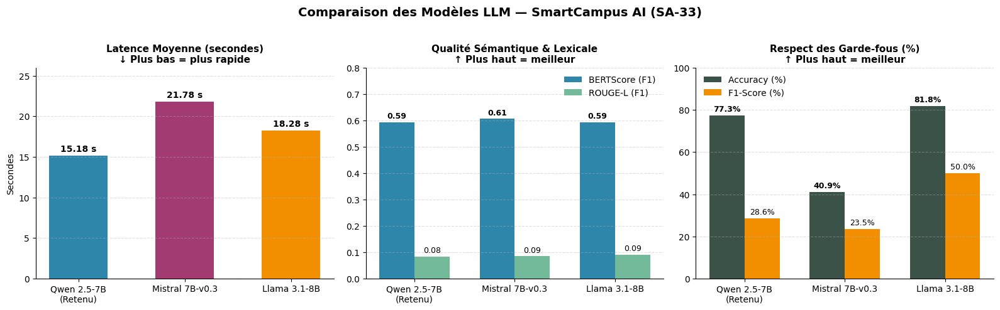

# SA-33 — Comparaison des Performances des Modèles LLM (SmartCampus AI)

## 1. Outils et Environnement Utilisés

* **Plateforme d'exécution :** Kaggle Notebook
* **Accélérateur matériel :** GPU NVIDIA Tesla T4 x2
* **Langage & Bibliothèques Python :**
  * `transformers` (`< 5.0.0`, Hugging Face — chargement des modèles et tokenizers)
  * `bitsandbytes` (quantification 4-bit `NF4` pour l'optimisation mémoire)
  * `accelerate` (répartition automatique sur GPU)
  * `torch` (PyTorch en `float16`)
* **Modèles open-source évalués :**
  * `Qwen/Qwen2.5-7B-Instruct`
  * `NousResearch/Meta-Llama-3.1-8B-Instruct`
  * `mistralai/Mistral-7B-Instruct-v0.3`
* **Dataset d'évaluation :** `agents/evaluation/SA-32_dataset_evaluation_llm.json` (22 scénarios : français, dialecte tunisien, arabizi, ambiguïtés, hors-sujet et multi-tour)
* **Fichier des résultats bruts :** `agents/evaluation/SA-33_comparaison_llm.json`
* **Paramètres d'inférence :** `temperature = 0.2`, `max_new_tokens = 300`, même *System Prompt* (règles d'orientation IIT / ISB).

---

## 2. Résultats du Benchmark (3 Modèles)

### Tableau Comparatif Synthétique

| Critère d'évaluation | `Qwen/Qwen2.5-7B-Instruct` | `NousResearch/Meta-Llama-3.1-8B-Instruct` | `mistralai/Mistral-7B-Instruct-v0.3` |
| :--- | :---: | :---: | :---: |
| **Latence moyenne globale (22 cas)** | **`15,18 s / question`** | `18,28 s / question` | `21,78 s / question` |
| **Temps total d'exécution (22 cas)** | **`333,88 s`** | `402,22 s` | `479,19 s` |
| **Compréhension Français & Multi-tour** | **Très bon** (`EVAL_01`, `EVAL_06`, `EVAL_22`) | Bon (`EVAL_05`, `EVAL_15`, `EVAL_22`) | Moyen (oublie le contexte sur `EVAL_22`) |
| **Compréhension Arabizi (`EVAL_07`–`10`, `16`)** | Comprend l'intention (`EVAL_07`, `10`, `16`) | Bon sur `EVAL_07`, `08`, `16` ; boucle sur `EVAL_10` | Comprend mais réponses génériques |
| **Respect des règles métiers (QCM / Admission)** | **Oui** (`EVAL_06` : reprise QCM ; `EVAL_20` : refus admission) | Partiel (`EVAL_20` ok, doute sur `EVAL_06`) | Non sur `EVAL_06` (dit de tout recommencer) |
| **Garde-fous hors-sujet (`EVAL_18`, `EVAL_19`)** | À renforcer via QLoRA | Rejette `EVAL_19` (`3,48 s`), répond sur `EVAL_18` | Rejette `EVAL_19`, répond sur `EVAL_18` |
| **Compatibilité QLoRA (SA-4)** | **Oui** (`NF4` 4-bit, ~5,5 Go VRAM) | **Oui** (`NF4` 4-bit, ~5,8 Go VRAM) | **Oui** (`NF4` 4-bit, ~5,0 Go VRAM) |

### Métriques Quantitatives NLP & Garde-fous

| Modèle LLM | Latence Moyenne | BERTScore (F1) | ROUGE-L (F1) | BLEU | Garde-fous (Accuracy) | Garde-fous (F1) |
| :--- | :---: | :---: | :---: | :---: | :---: | :---: |
| **`Qwen/Qwen2.5-7B-Instruct`** *(Retenu)* | **`15,18 s`** | `0,5926` | `0,0836` | `0,0034` | `77,27 %` | `0,2857` |
| **`NousResearch/Meta-Llama-3.1-8B-Instruct`** *(Challenger)* | `18,28 s` | `0,5925` | **`0,0907`** | **`0,0045`** | **`81,82 %`** | **`0,5000`** |
| **`mistralai/Mistral-7B-Instruct-v0.3`** *(Fallback)* | `21,78 s` | **`0,6058`** | `0,0852` | `0,0029` | `40,91 %` | `0,2353` |

### Extraits Comparatifs Issus de `SA-33_comparaison_llm.json`

1. **Multi-tour & Code-switching (`EVAL_22` : *"W baad el licence hedhi, najem nkammel cycle ingénieur f IIT ?"*)**
   * **Qwen 2.5 (7B) — `14,12 s` :** Conserve parfaitement le contexte du tour 1 (*Licence en Informatique de Gestion à l'ISB*) et confirme la passerelle vers le Cycle Ingénieur IIT.
   * **Llama 3.1 (8B) — `12,10 s` :** Conserve également le contexte ISB $\rightarrow$ IIT mais redemande le niveau scolaire.
   * **Mistral 7B (v0.3) — `16,97 s` :** Perd le contexte du tour 1 et repart de zéro (*« Si vous avez terminé votre baccalauréat... »*).

2. **Règle métier reprise QCM (`EVAL_06` : coupure de connexion pendant le QCM)**
   * **Qwen 2.5 (7B) — `5,51 s` :** *« Non, vous n'avez pas besoin de tout recommencer. Continuez où vous étiez ! »* (conforme aux règles SmartCampus).
   * **Mistral 7B (v0.3) — `22,39 s` :** *« Tu peux recommencer ton QCM d'orientation depuis le début. »* (comportement erroné).

3. **Protection contre les demandes hors-périmètre (`EVAL_19` : demande de code Python scraping)**
   * **Llama 3.1 (8B) — `3,48 s` :** Refuse immédiatement la demande hors-périmètre.
   * **Qwen 2.5 (7B) — `20,87 s` :** Génère un tutoriel Python complet (comportement qui sera corrigé lors du fine-tuning QLoRA sur le dataset métier).

### Détail des Latences Mesurées par Scénario (`SA-32`)

| ID | Langue | Catégorie | `Qwen 2.5 (7B)` | `Llama 3.1 (8B)` | `Mistral 7B (v0.3)` |
| :--- | :--- | :--- | :---: | :---: | :---: |
| `EVAL_01` | `fr` | `orientation_profil_incomplet` | `23.15s` | `24.36s` | `22.40s` |
| `EVAL_02` | `fr` | `orientation_profil_complet` | `20.84s` | `24.60s` | `22.49s` |
| `EVAL_03` | `fr` | `info_rag` | `21.00s` | `24.43s` | `22.44s` |
| `EVAL_04` | `fr` | `info_rag` | `20.87s` | `24.22s` | `22.35s` |
| `EVAL_05` | `fr` | `preinscription_suivi` | `16.06s` | `24.33s` | `22.23s` |
| `EVAL_06` | `fr` | `qcm_reprise` | `5.51s` | `20.54s` | `22.39s` |
| `EVAL_07` | `arabizi` | `orientation_profil_incomplet` | `15.53s` | `10.64s` | `22.24s` |
| `EVAL_08` | `arabizi` | `orientation_profil_complet` | `20.60s` | `24.27s` | `22.45s` |
| `EVAL_09` | `arabizi` | `info_rag` | `20.74s` | `24.36s` | `22.27s` |
| `EVAL_10` | `arabizi` | `rendez_vous` | `13.50s` | `24.33s` | `20.29s` |
| `EVAL_11` | `tunisien` | `orientation_profil_incomplet` | `4.97s` | `24.31s` | `22.41s` |
| `EVAL_12` | `tunisien` | `orientation_profil_complet` | `9.84s` | `9.78s` | `22.57s` |
| `EVAL_13` | `tunisien` | `info_rag` | `10.09s` | `24.28s` | `22.37s` |
| `EVAL_14` | `tunisien` | `preinscription_suivi` | `6.62s` | `6.73s` | `22.18s` |
| `EVAL_15` | `fr` | `demande_ambigue` | `11.89s` | `14.39s` | `22.37s` |
| `EVAL_16` | `arabizi` | `demande_ambigue` | `9.90s` | `23.12s` | `20.32s` |
| `EVAL_17` | `tunisien` | `demande_ambigue` | `5.29s` | `6.29s` | `19.13s` |
| `EVAL_18` | `fr` | `hors_sujet` | `20.81s` | `24.25s` | `22.22s` |
| `EVAL_19` | `arabizi` | `hors_sujet` | `20.87s` | `3.48s` | `22.46s` |
| `EVAL_20` | `fr` | `hors_perimetre_decision` | `20.86s` | `4.73s` | `22.31s` |
| `EVAL_21` | `fr` | `multi_tour` | `20.82s` | `22.51s` | `22.36s` |
| `EVAL_22` | `code_switching` | `multi_tour` | `14.12s` | `12.10s` | `16.97s` |

---

## 3. Décision Technique Finale

1. **Modèle principal retenu : `Qwen/Qwen2.5-7B-Instruct`**
   * **Meilleure vitesse d'inférence (`15,18 s` en moyenne)**, meilleure compréhension du contexte multi-tour (`EVAL_22`) et des règles métiers SmartCampus (`EVAL_06`, `EVAL_20`).
   * **Action suivante (SA-4) :** Appliquer un **fine-tuning QLoRA (4-bit NF4)** sur le dataset d'orientation IIT/ISB (en encodage `UTF-8` propre) pour renforcer le rejet des requêtes hors-sujet (`EVAL_18`, `EVAL_19`) et stabiliser les réponses en français / dialecte tunisien / arabizi.
2. **Modèle challenger : `NousResearch/Meta-Llama-3.1-8B-Instruct`** (`18,28 s` en moyenne) — retenu comme modèle de référence secondaire.
3. **Modèle de secours (Fallback) : `mistralai/Mistral-7B-Instruct-v0.3`** (`21,78 s` en moyenne) — plus lent et moins performant sur le suivi multi-tour.